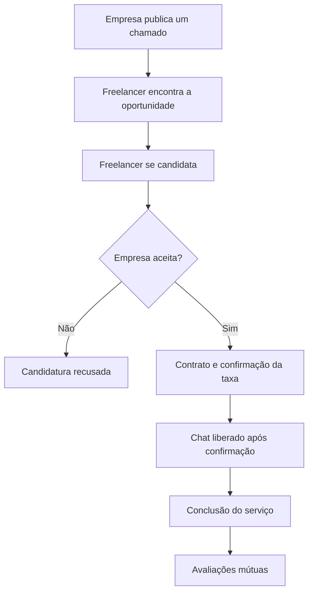
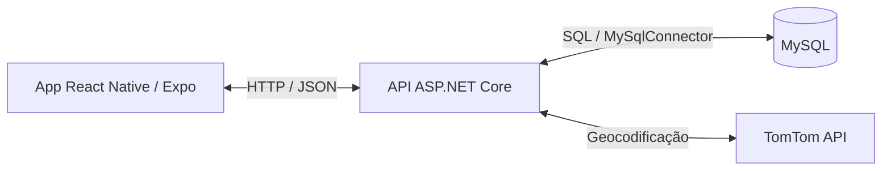
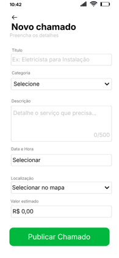
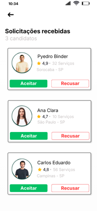
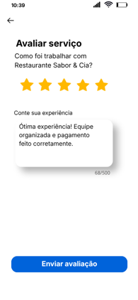

<div align="center">

# TaskFlow

**Conectando quem precisa com quem faz.**

Plataforma mobile full stack para intermediação de serviços freelancers sob demanda.


[Sobre](#sobre-o-projeto) · [Funcionalidades](#funcionalidades) · [Arquitetura](#arquitetura) · [Interface](#interface) · [Execução](#como-executar) · [Créditos](#créditos)

</div>

## Sobre o projeto

O **TaskFlow** foi desenvolvido em equipe como Trabalho de Conclusão de Curso (TCC) de Análise e Desenvolvimento de Sistemas, em 2026, no Centro Universitário Anhembi Morumbi — Sorocaba/SP.

A proposta é facilitar a contratação de profissionais autônomos para serviços gerais, eventos e demandas rápidas, reduzindo a informalidade e centralizando a publicação de oportunidades, a seleção de profissionais, a comunicação e as avaliações em um único aplicativo.

O projeto reúne um frontend em React Native, uma API REST em ASP.NET Core e um banco de dados relacional MySQL. Trata-se de um projeto acadêmico executado em ambiente local, não de uma plataforma comercial em produção.

## Funcionalidades

| Freelancer | Empresa / contratante |
| --- | --- |
| Cadastro, login e edição de perfil | Cadastro, login e gerenciamento de perfil |
| Consulta de chamados em lista e mapa | Publicação e gerenciamento de chamados |
| Busca e filtros de oportunidades | Definição de local, data, valor e quantidade de profissionais |
| Candidatura e acompanhamento de solicitações | Visualização de candidatos e seus perfis |
| Perfil profissional, habilidades e portfólio | Aceite ou recusa de candidaturas |
| Comunicação após confirmação do serviço | Fluxo demonstrativo de pagamento da taxa |
| Notificações internas e avaliações | Chat, conclusão do serviço e avaliação do freelancer |

O sistema também contempla suporte a tema claro e escuro.

### Fluxo principal de contratação



O fluxo de pagamento é demonstrativo, sem transações financeiras reais. As notificações apresentadas no aplicativo fazem parte do fluxo interno de eventos do sistema.

## Tecnologias utilizadas

| Camada | Tecnologias |
| --- | --- |
| Frontend | React Native, React, Expo SDK 54, Expo Router, TypeScript |
| Interface e armazenamento local | React Native SVG, AsyncStorage |
| Backend | C#, ASP.NET Core Web API (.NET 10), MySqlConnector |
| Banco de dados | MySQL |
| Localização e mapas | Expo Location, TomTom (endereços e geocodificação), mapas interativos |
| Comunicação | HTTP, API REST, JSON |
| Versionamento | Git e GitHub |

## Arquitetura



O aplicativo envia requisições HTTP à API, responsável por processar as operações, aplicar as regras de negócio e consultar ou persistir os dados no MySQL. A API retorna as respostas em JSON para atualização das telas do aplicativo.

Entre as regras de negócio estão a candidatura a chamados, o aceite ou recusa pela empresa, a criação de contratos, o controle do fluxo de contratação e a associação de mensagens, notificações e avaliações aos registros correspondentes.

### Banco de dados

O banco relacional organiza entidades como usuários, empresas, freelancers, categorias, chamados, candidaturas, contratos, mensagens, notificações e avaliações. As relações permitem acompanhar as diferentes etapas da contratação e vincular os dados aos participantes corretos.

### Estrutura do repositório

```text
Taskflow/
├── assets/                     # Imagens, ícones e recursos do aplicativo
├── src/                        # Frontend React Native
│   ├── app/                    # Telas e rotas (Expo Router)
│   ├── services/               # Comunicação HTTP e armazenamento local
│   └── styles/                 # Estilos e identidade visual
├── backend/
│   └── TaskFlowApi/            # API ASP.NET Core
│       ├── TaskFlowApi.csproj
│       └── appsettings.Development.example.json
├── docs/
│   └── screenshots/            # Referências visuais do TCC
├── app.json
├── package.json
└── README.md
```

O frontend encontra-se na raiz do repositório. O backend está separado em `backend/TaskFlowApi`.

## Interface

As imagens abaixo são **capturas da interface da aplicação** e apresentam alguns dos principais fluxos implementados no TaskFlow.

<div align="center">
<table>
  <tr>
    <th>Entrada</th><th>Home</th><th>Mapa</th><th>Novo chamado</th>
  </tr>
  <tr>
    <td></td>
    <td></td>
    <td></td>
    <td></td>
  </tr>
  <tr>
    <th>Candidatos</th><th>Pagamento</th><th>Chat</th><th>Avaliação</th>
  </tr>
  <tr>
    <td></td>
    <td></td>
    <td></td>
    <td></td>
  </tr>
</table>
</div>

## Como executar

### Pré-requisitos

- Git;
- Node.js LTS compatível com Expo SDK 54 e npm;
- .NET SDK 10;
- MySQL Server (MySQL Workbench opcional);
- Uma chave própria da API TomTom para os recursos de endereço/geocodificação;
- Expo Go compatível com o SDK do projeto ou emulador Android, caso queira executar no mobile.

### 1. Clonar o repositório

```bash
git clone https://github.com/SEU_USUARIO/Taskflow.git
cd Taskflow
```

### 2. Preparar o banco MySQL

Crie o banco de dados:

```sql
CREATE DATABASE IF NOT EXISTS taskflow_db
  CHARACTER SET utf8mb4;
```

Importe a estrutura SQL correspondente à versão final do projeto (tabelas, relacionamentos e dados de referência necessários). Um banco vazio, sem as tabelas, não permite executar os fluxos da aplicação.

A estrutura do banco deve ser preparada localmente antes da execução da aplicação. Caso seja utilizada uma exportação do ambiente acadêmico original, recomenda-se manter apenas a estrutura e dados de referência necessários, sem dados pessoais ou registros de testes.

### 3. Backend (API)

A partir da raiz do repositório:

```bash
cd backend/TaskFlowApi
dotnet restore
```

Na pasta da API, copie `appsettings.Development.example.json` para `appsettings.Development.json`.

No PowerShell:

```powershell
Copy-Item appsettings.Development.example.json appsettings.Development.json
```

No Bash:

```bash
cp appsettings.Development.example.json appsettings.Development.json
```

Edite a cópia local utilizando as credenciais do seu próprio ambiente:

```json
{
  "ConnectionStrings": {
    "DefaultConnection": "Server=localhost;Port=3306;Database=taskflow_db;User=SEU_USUARIO;Password=SUA_SENHA;"
  },
  "TomTom": {
    "ApiKey": "SUA_CHAVE_TOMTOM"
  }
}
```

Mantenha também as demais configurações presentes no arquivo de exemplo. Em seguida, inicie a API em modo Development. No PowerShell:

```powershell
$env:ASPNETCORE_ENVIRONMENT = "Development"
dotnet run --no-launch-profile --urls "http://0.0.0.0:5275"
```

No Bash:

```bash
ASPNETCORE_ENVIRONMENT=Development dotnet run --no-launch-profile --urls "http://0.0.0.0:5275"
```

A API deverá responder em `http://localhost:5275`. Com o banco configurado, experimente acessar `http://localhost:5275/api/Chamados` no navegador. Mantenha esse terminal aberto.

### 4. Frontend (app)

Abra outro terminal na raiz do repositório:

```bash
npm install
npx expo start
```

Para executar no navegador:

```bash
npm run web
```

Para executar em um emulador Android configurado:

```bash
npm run android
```

### 5. Conexão no celular

O frontend utiliza `src/services/api.ts` para configurar o endereço da API. Na execução mobile, altere `MOBILE_API_HOST` para o IPv4 local do computador que está executando o backend:

```typescript
const MOBILE_API_HOST = "SEU_IP_LOCAL";
```

Mantenha o celular e o computador na mesma rede Wi-Fi, verifique se a porta 5275 está liberada no firewall para a rede privada e escaneie o QR Code do Expo com um cliente compatível. No emulador Android padrão, o endereço do host normalmente é `10.0.2.2`.

> No navegador do próprio computador, o frontend utiliza o host local. No celular físico, `localhost` corresponde ao próprio celular, e não ao computador que executa a API.

## Configurações e limitações

- O ambiente é voltado a testes e demonstrações locais. Não exponha a API de desenvolvimento diretamente à internet.
- Não publique senhas do MySQL, chaves da TomTom, arquivos de configuração privados ou dados pessoais de usuários.
- O pagamento é simulado; não há processamento de dinheiro real neste projeto acadêmico.
- Uma implantação comercial exigiria revisão de autenticação, autorização, segurança, privacidade e infraestrutura, além de uma integração real de pagamentos.

## Documentação acadêmica

A documentação escrita do TCC pode ser disponibilizada na pasta `docs/academico/`, preservando o README como uma visão rápida e técnica do projeto.

Caso o relatório final seja publicado, recomenda-se utilizar uma versão revisada para portfólio, removendo dados pessoais, assinaturas, informações sensíveis e outros conteúdos que não precisem ficar públicos.

> O documento acadêmico completo deve ser publicado apenas se todos os autores envolvidos estiverem de acordo e se não houver restrições institucionais à divulgação.

## Contexto acadêmico e contribuição

**Título do TCC:** Desenvolvimento de aplicativo mobile para intermediação de serviços freelancers sob demanda.

**Curso:** Análise e Desenvolvimento de Sistemas — Centro Universitário Anhembi Morumbi, Sorocaba/SP (2026).

Neste portfólio, destaco minha participação em **[DESCREVA AQUI SUA CONTRIBUIÇÃO REAL NO PROJETO]**. Exemplos: desenvolvimento de telas, API, integração com banco de dados, regras de negócio, testes, documentação, modelagem, correção de bugs ou organização do projeto.

## Créditos

Projeto desenvolvido em equipe por:

- Alan Bernardo Riscala da Silva
- Anderson Gabriel Brasil Dantas
- Anna Clara Martinez Dias
- Gabriel Portella de Moraes
- Pyedro Henrique Corrêa Binder
- Vitor Rodrigue de Oliveira

**Orientador:** Prof. Anderson Reis de Campos.

[Repositório acadêmico original](https://github.com/AthonEdu/2026-1-freelancer)

Esta versão pública preserva o contexto acadêmico e reconhece o trabalho coletivo. Nenhuma licença de redistribuição é concedida por este README; a definição de uma licença deve ser acordada com os responsáveis pelo projeto.
